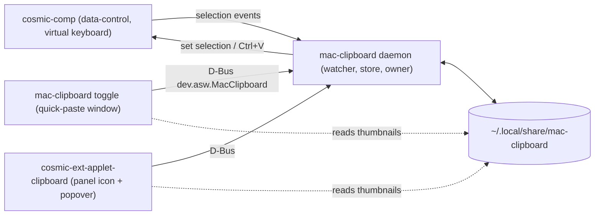

# Clipboard manager plan

Goal: replace the third-party `clippy-land` panel applet with our own clipboard
history: a small daemon that remembers what you copy, a menu bar icon with a
quick list, and a Spotlight-style quick-paste window on `Super+V`. It should
look like the rest of the macOS preset and never keep passwords.

## Decisions

| Question | Choice |
|---|---|
| Where history lives | A per-user daemon, `mac-clipboard daemon`, not the panel applet (the panel restarts; history must not) |
| How the clipboard is read | `ext-data-control-v1`, falling back to `zwlr-data-control-v1`, through `wl-clipboard-rs` 0.9 (`Watcher` + `copy`) |
| Storage | `~/.local/share/mac-clipboard/`: a JSON index plus content-addressed blobs. No database, no C dependencies |
| How the UI talks to the daemon | D-Bus, `dev.asw.MacClipboard` on the session bus (zbus) |
| Quick-paste window | A layer-shell surface in the same binary (`mac-clipboard toggle`), like the Spotlight launcher |
| Panel icon | A new applet overlay, `cosmic-ext-applet-clipboard`, in `upstream-applets` next to the dock and clock |
| Paste into the app | Enter copies the item; auto-paste (sending `Ctrl+V`) is a setting, on by default, done through `zwp_virtual_keyboard_v1` |
| Passwords | Never stored when the source marks them (`x-kde-passwordManagerHint: secret`) or comes from a password manager |

## Where it stands

- The preset puts `io.github.k33wee.clippy-land` in the right wing of the panel
  (`presets/macos-glass/com.system76.CosmicPanel.Panel/v1/plugins_wings`, and
  the copy `install-clock-center.sh` writes in `write_panel_layout`).
- It is an AUR package. `install.sh --check` and the README only mention it;
  `cosmic-preset apply` warns when it is missing.
- It keeps text only, has no images, files, search window, pinning or password
  filter, and its look does not match the dock and the clock popup.
- Our own code that would host the replacement exists in two places:
  `apps/mac-suite/` (Calendar, Mail, Theme; built against `libcosmic-mac`, has
  the `wayland` feature for layer surfaces) and `overlays/cosmic-applets/`
  (applets built inside the `upstream-applets` workspace, which `setup.sh`
  copies in and `patches/cosmic-applets.patch` registers as members).
- What the system gives us: COSMIC 1.11's compositor serves both
  `ext_data_control` and `wlr_data_control` and `zwp_virtual_keyboard_v1` to
  any non-sandboxed client (`cosmic-comp/src/state.rs`), with no environment
  switch. `wl-clipboard-rs` 0.9.4 is already in the cargo cache and speaks both
  data-control protocols. `Super+V` is not bound by default.

## Parts



| Piece | Where | Binary / id |
|---|---|---|
| Core library: item model, store, dedup, filters, search | `apps/mac-suite/mac-clipboard/src/{model,store,filter,search}.rs` | lib `mac_clipboard` |
| Daemon: watcher, owner, D-Bus service | `apps/mac-suite/mac-clipboard/src/daemon/` | `mac-clipboard daemon` |
| Quick-paste window | `apps/mac-suite/mac-clipboard/src/ui/` | `mac-clipboard toggle` / `show` / `hide` |
| Panel applet | `overlays/cosmic-applets/cosmic-ext-applet-clipboard/` | `dev.asw.CosmicExtAppletClipboard` |
| Install | `install-clipboard.sh`, a `clipboard` component in `install.sh` | `~/.local/bin/mac-clipboard`, `~/.local/bin/cosmic-ext-applet-clipboard` |

One binary with subcommands keeps the daemon and the window on one build of
the store code. The applet lives in the applets workspace (stock libcosmic, as
the panel expects) and shares nothing with the daemon but the D-Bus interface
and the on-disk thumbnail paths, so the two workspaces never need to agree on
crate versions.

## The daemon

### Watching

- A dedicated thread runs `wl_clipboard_rs::watch::Watcher` on the regular
  clipboard. The primary selection (middle-click) is ignored by default and
  can be turned on in settings.
- For each new offer, look at the advertised MIME types first and decide what
  to fetch before reading any bytes:

| Kind | MIME types (first match wins) | Stored as |
|---|---|---|
| Files | `x-special/gnome-copied-files`, `text/uri-list` with only `file://` URIs | list of paths + copy/cut flag |
| Image | `image/png`, then `image/jpeg`, `image/webp`, `image/bmp`, `image/tiff` | PNG blob (converted with `image`) + 256 px thumbnail |
| Rich text | `text/html` (always together with the plain text) | HTML blob + plain text |
| Link | plain text that is a single `http(s)://`, `mailto:` or `ftp://` URL | text, kind `Link` |
| Text | `text/plain;charset=utf-8`, `UTF8_STRING`, `text/plain`, `STRING`, `TEXT` | text blob |

- Reads use a 2 s timeout per MIME type and a size cap (below), so a stuck or
  malicious source cannot hang the daemon.
- Our own selections carry a marker MIME type,
  `application/x-mac-clipboard-owner`, so the watcher skips the event it caused
  when we put an item back on the clipboard.

### Keeping the clipboard alive

On Wayland the clipboard dies with the app that copied. When the selection
becomes empty and the last item came from an app that has since gone away,
the daemon offers that item again ("Keep clipboard after apps close", on by
default; never for sensitive items).

### Becoming the owner

Choosing an item makes the daemon the selection source with
`wl_clipboard_rs::copy::Options::copy_multi`, offering every stored type:
text gets all plain-text aliases, rich text adds `text/html`, images offer
`image/png`, files offer `text/uri-list` and `x-special/gnome-copied-files`.
"Paste as plain text" (`Shift+Enter`) offers only the plain-text aliases. The
source runs in its own serving thread and is dropped when anything else takes
the clipboard.

### Auto-paste

After setting the clipboard and closing the window, the daemon waits for the
keyboard focus to return (about 80 ms), then sends `Ctrl+V` through a
`zwp_virtual_keyboard_v1` keyboard with a minimal keymap. Terminals
(`com.system76.CosmicTerm`, `org.gnome.Ptyxis`, `kitty`, `Alacritty`,
`foot`, `org.wezfurlong.wezterm`) get `Ctrl+Shift+V`; the focused app id comes
from `ext-foreign-toplevel-list` / cosmic toplevel info, the same protocols the
dock already uses (`cosmic-ext-dock/src/wayland_handler.rs`). If the virtual
keyboard is unavailable the item is still copied and a short "Copied" toast
shows instead.

### D-Bus interface `dev.asw.MacClipboard` (object `/dev/asw/MacClipboard`)

| Member | Purpose |
|---|---|
| `List(filter: s, query: s, limit: u) -> a(...)` | Items for a view: id, kind, preview, thumbnail path, size, time, pinned, source app |
| `Get(id) -> a{sv}` | Full text/HTML/paths for the preview pane |
| `Activate(id, plain: b, paste: b)` | Put on the clipboard, optionally paste |
| `Pin(id, pinned: b)`, `Remove(id)`, `Clear(keep_pinned: b)` | Editing |
| `SetPaused(b)` | "Pause history" (incognito) from the applet |
| `Toggle()` | Show/hide the quick-paste window (what `Super+V` calls) |
| signal `Changed(revision: t)` | UIs refresh their list |
| property `Paused`, `Count` | Applet icon state |

The daemon is the only writer. If it is not running, `mac-clipboard toggle`
starts it first (D-Bus name activation through a user service file in
`~/.local/share/dbus-1/services/dev.asw.MacClipboard.service`).

## Storage

```
~/.local/share/mac-clipboard/        (mode 0700)
  index.json                         item list, newest first, written atomically
  blobs/ab/ab3f...e1                 payloads, named by SHA-256 (`sha2`) hash (0600)
  blobs/ab/ab3f...e1.meta            kind, MIME types, times (for index recovery)
  thumbs/ab3f...e1.png               256 px image thumbnails
  pins.json                          pinned ids and their order
```

- **Item**: `id`, `kind` (Text, Link, RichText, Image, Files), `hash`, MIME
  types and blob refs, a 512-character preview for search and rows,
  `created`, `last_used`, `use_count`, `pinned`, `source_app` (best guess from
  the focused window at copy time).
- **Index writes** go to `index.json.tmp`, `fsync`, then `rename`. A corrupt or
  unreadable index is moved aside (`index.json.broken-<time>`) and rebuilt
  from blobs that have a sidecar `.meta`; history is never silently wiped.
- **Ring buffer**: keep at most `max_items` (default 500) unpinned items and
  `max_bytes` (default 256 MiB) of blobs. When over, drop the oldest unpinned
  items by `last_used`; blobs no longer referenced are deleted. Pinned items
  never age out (separate cap, default 100).
- **Per-item caps**: text 1 MiB, HTML 2 MiB, images 32 MiB raw / 40 megapixels
  decoded; larger offers are recorded as a "too large" placeholder or skipped
  (setting).
- **Deduplication**: the hash is over the canonical content (normalised line
  endings for text, decoded pixels for images, sorted paths for files). Copying
  the same thing again moves the existing item to the top and bumps
  `last_used`/`use_count` instead of adding a new row. An HTML copy whose plain
  text equals an existing text item upgrades that item.
- **Expiry**: optional "Forget items after" (Never, 1 day, 7 days, 30 days),
  pinned items excepted.
- **Settings** through `cosmic-config` id `dev.asw.MacClipboard` (v1): limits,
  expiry, primary selection, keep-alive, auto-paste, ignored apps, hotkey hint,
  pause state.

## Sensitive content

Nothing marked secret ever reaches the disk or the UI.

1. **Marked by the source**: skip the offer if it advertises
   `x-kde-passwordManagerHint` (KeePassXC, KWallet, Bitwarden desktop send
   `secret`) or `application/x-kde-passwordManagerHint`, or a GNOME-style
   `x-gnome-sensitive` type. Only the type list is read, never the bytes.
2. **Ignored apps**: if the focused app at copy time is in the ignore list
   (defaults: `org.keepassxc.KeePassXC`, `com.bitwarden.desktop`,
   `1password`, `org.gnome.seahorse.Application`), skip it. Password fields in
   ordinary apps cannot be detected this way; those rely on rule 1.
3. **Transient clear**: when a password manager clears the clipboard after its
   timeout, the selection goes empty; the keep-alive feature never resurrects
   an item from an ignored app or one copied less than 1 s before being
   replaced by an empty selection.
4. **Pause**: "Pause history" in the applet menu stops recording until turned
   back on (or for 15 min / 1 h / until logout); the menu bar icon shows a
   slashed variant while paused.
5. **Clearing**: "Clear history" (keep pins / everything), per-item Delete, and
   `mac-clipboard clear` on the command line. Clearing deletes blobs and
   thumbnails, not just index entries.

Optional, off by default: a heuristic that flags likely secrets (long
high-entropy single tokens, `-----BEGIN ... PRIVATE KEY-----`, `ghp_`/`sk-`
style API keys) and stores them masked with a 60 s expiry.

## The look

Matches the dock, the clock popup and the Spotlight window: frosted glass
(`frosted_system_interface` from the preset theme, blur from the compositor),
`radius_l` (16 px) outer corners, `radius_s` (8 px) rows, macOS blue accent
for the selection, SF-like typography from the COSMIC theme fonts.

### Panel icon and popover (`cosmic-ext-applet-clipboard`)

- A monochrome clipboard glyph (`edit-paste-symbolic`, slashed variant when
  paused) at the panel's symbolic icon size, with the same pill-shaped hover
  as the other menu bar items (see `docs/panel-toolbar-plan.md`).
- Click opens a 360 px popover: search field, the 10 most recent items
  (thumbnail or one-line preview, relative time, pin marker), then
  "Show All… ⌘V" (opens the quick-paste window), "Pause History",
  "Clear History…", "Clipboard Settings…".
- Left click on a row copies it; right click offers Pin, Paste as Plain Text,
  Delete. The applet desktop file sets `X-CosmicHoverPopup=Auto` like the clock.

### Quick-paste window (`mac-clipboard toggle`)

```
┌──────────────────────────────────────────────────────────────┐
│ 🔍  Search clipboard                                    ⌘V   │
│ [All] [Text] [Images] [Links] [Files] [Pinned]               │
├────────────────────────────┬─────────────────────────────────┤
│ 1  📌 ssh deploy@host …   2m│                                 │
│ 2  🖼 Screenshot 1920×1080 5m│        live preview             │
│ 3  🔗 github.com/pop-os/…  1h│   (text with wrapping, image    │
│ 4  📄 report.pdf, 2 more   1h│    fitted, HTML as plain text,  │
│ 5  Lorem ipsum dolor …     3h│    file list with icons)        │
│ …                          │   Copied from Firefox · 2 min  │
│                            │   212 characters · 3 lines      │
├────────────────────────────┴─────────────────────────────────┤
│ ↩ Paste   ⇧↩ Paste as Text   P Pin   ⌫ Delete   esc Close      │
└──────────────────────────────────────────────────────────────┘
```

- A layer-shell surface on the `Overlay` layer, centred on the output with
  the pointer, 760×460 px, `KeyboardInteractivity::Exclusive`, closes on focus
  loss or Escape. Built the same way as the restyled launcher
  (`apps/cosmic-launcher/src/app.rs` uses `SctkLayerSurfaceSettings`).
- **Search**: instant fuzzy match (`nucleo-matcher`) over previews, file names,
  link hosts and source app; matched characters highlighted; results ranked by
  match score, then pinned, then recency. The query keeps the active filter.
- **Filter pills**: All, Text (Text + RichText), Images, Links, Files, Pinned.
  Pill style is the panel's: rounded capsule, tinted when active.
- **Preview pane**: text in a monospace or body font depending on content,
  images scaled to fit with dimensions, files as icon + name + folder, links
  with host and full URL. Metadata line at the bottom.

### Keyboard

| Key | Action |
|---|---|
| `Super+V` (configurable) | Open/close the window |
| `↑` / `↓`, `Ctrl+P` / `Ctrl+N` | Move selection |
| `Enter` | Copy and paste (copy only if auto-paste is off) |
| `Shift+Enter` | Paste as plain text |
| `Ctrl+Enter` | Copy only, keep the window open |
| `1`–`9` (when the search field is empty), `Ctrl+1`–`Ctrl+9` (always) | Quick-select the nth visible item |
| `P` (search empty), `Ctrl+Shift+P` (always) | Pin / unpin |
| `Delete` / `Ctrl+Backspace` | Remove item |
| `Tab` / `Shift+Tab` | Next / previous filter pill |
| `Ctrl+F` or typing | Focus search |
| `Escape` | Clear search, then close |

Bare letter keys (`P`, digits) only act while the search field is empty; once
you type, they go to the search. The hotkey is a COSMIC custom shortcut
(`Spawn("mac-clipboard toggle")`) that the installer adds to
`~/.config/cosmic/com.system76.CosmicSettings.Shortcuts/v1/custom` by merging
one entry, never by overwriting the file.

## Install and preset integration

- `install-clipboard.sh` (and `./install.sh clipboard`, `needs`: `libcosmic
  applets`):
  - `cargo build --release -p mac-clipboard` in `apps/mac-suite` (adds
    `mac-clipboard` to the workspace members) and
    `-p cosmic-ext-applet-clipboard` in `upstream-applets`, with the same
    fresh-binary check the dock and clock scripts use.
  - Installs `~/.local/bin/mac-clipboard`, the applet binary and its desktop
    file (absolute `Exec`), the D-Bus service file, an autostart entry
    `~/.config/autostart/mac-clipboard.desktop` (`mac-clipboard daemon`), and
    the `Super+V` shortcut.
  - Replaces `io.github.k33wee.clippy-land` with
    `dev.asw.CosmicExtAppletClipboard` in the preset's `plugins_wings`.
  - `--uninstall` reverses each step, restores `clippy-land` in the layout and
    asks before deleting `~/.local/share/mac-clipboard`.
- **Panel layout ownership**: today `install-clock-center.sh` rewrites the
  whole `plugins_wings` and would put `clippy-land` back. Before this lands,
  move layout writing into one helper, `tools/panel-layout.sh`, that builds
  `plugins_wings`/`plugins_center` from the preset file with per-slot
  substitutions (`clipboard=dev.asw.CosmicExtAppletClipboard`,
  `clock=dev.asw.CosmicExtAppletClockCenter`), so each installer changes only
  its own slot. The panel toolbar plan uses the same helper.
- `setup.sh`, `tools/export.sh` and `patches/cosmic-applets.patch` learn the
  new overlay directory (`cosmic-ext-applet-clipboard`), like the dock and
  clock.
- README: new component row, drop `clippy-land` from Requirements and
  `install.sh --check`.

## Phases

### Phase 1: Core and daemon (no UI)

- `mac-clipboard` crate: model, store, dedup, ring buffer, sensitive filter,
  settings.
- Daemon: watcher thread, MIME selection, image conversion and thumbnails,
  owner/serving thread, keep-alive, D-Bus service.
- CLI for testing and scripting: `mac-clipboard list|get|copy <id>|pin|rm|clear|pause`.
- Done when: copying text, HTML, a screenshot and files from COSMIC Files shows
  up in `mac-clipboard list` with correct kinds; `copy <id>` pastes correctly
  in another app; KeePassXC copies never appear.

### Phase 2: Quick-paste window

- Layer-shell window, search, pills, list, preview pane, keyboard map.
- `Super+V` shortcut, auto-paste through the virtual keyboard, terminal
  detection.
- Done when: `Super+V`, type, `Enter` pastes into gedit/Text Editor, Firefox,
  COSMIC Terminal and a GTK app without touching the mouse.

### Phase 3: Panel applet

- `cosmic-ext-applet-clipboard`: icon, paused state, popover, context menu,
  "Show All".
- `tools/panel-layout.sh`, preset change, `clippy-land` removed from docs and
  checks.
- Done when: `cosmic-preset apply macos-glass` shows our icon in place of
  `clippy-land` and no "applet not installed" warning.

### Phase 4: Polish

- Expiry, secret heuristic, primary-selection option, settings page (a small
  window from "Clipboard Settings…"), "Copied" toast, i18n (`fl!` like the
  clock applet), drag an item out of the window into an app.

## How it will be checked

- `cargo test -p mac-clipboard` with a corpus in
  `apps/mac-suite/mac-clipboard/tests/corpus/`:
  - **MIME selection**: offer lists from Firefox, Chromium, LibreOffice,
    COSMIC Files, GIMP, KeePassXC, a terminal; assert chosen kind and types.
  - **Dedup**: CRLF vs LF text, the same PNG re-encoded, HTML upgrading text,
    file lists in different order.
  - **Ring buffer**: eviction by count and by bytes, pinned items surviving,
    orphaned blobs deleted.
  - **Store**: round trip, atomic write interrupted (temp file left behind),
    corrupt `index.json` moved aside and recovered.
  - **Sensitive**: every hint variant skipped without reading bytes; ignored
    apps; keep-alive never re-offers a sensitive item.
  - **Search**: ranking fixtures (exact > prefix > fuzzy, pinned tie-break),
    filter pills.
  - **Links/files**: URL detection edge cases, `file://` URI decoding with
    spaces and Unicode, cut vs copy in `gnome-copied-files`.
- Integration test (ignored by default, `cargo test -- --ignored`): run the
  watcher against a headless `sway`/`weston` with data-control, drive it with
  `wl-copy`/`wl-paste`, check items and the owner offers.
- Manual checks in a COSMIC session:
  - Copy plain text, a Firefox selection (HTML), a link, a screenshot
    (`cosmic-screenshot` to clipboard), files and a cut in COSMIC Files; each
    appears once with the right icon and preview.
  - Close the source app; paste still works (keep-alive).
  - KeePassXC copy: not listed; after its clear timeout nothing comes back.
  - `Super+V` → `3` pastes the third item; `Shift+Enter` pastes plain text
    into LibreOffice; terminal gets `Ctrl+Shift+V`.
  - Pause, copy, unpause: nothing recorded while paused.
  - Fill past 500 items / 256 MiB; oldest unpinned go, pins stay, disk usage
    drops.
  - `pkill cosmic-panel`: applet comes back, history intact. Log out and in:
    daemon autostarts, history intact.
  - `cosmic-preset revert`: our applet gone from the panel, daemon still safe
    to leave running; `./install-clipboard.sh --uninstall` removes everything.

## Risks

- **Auto-paste**: some apps ignore virtual keyboard input or map `Ctrl+V`
  differently; the setting can turn it off, and copying always works.
- **Large images**: decoding a huge clipboard image costs memory; caps and a
  worker thread keep the daemon responsive.
- **Source app guess**: data-control does not say who copied. The focused
  window at copy time is right almost always, but the ignore list is a second
  line behind the password-manager hint, not the main protection.
- **Two writers of the panel layout**: until `tools/panel-layout.sh` exists,
  reinstalling the clock would bring `clippy-land` back.
- **Protocol changes**: `ext-data-control-v1` is new; keeping the `wlr`
  fallback (which `wl-clipboard-rs` handles) covers older compositors.
